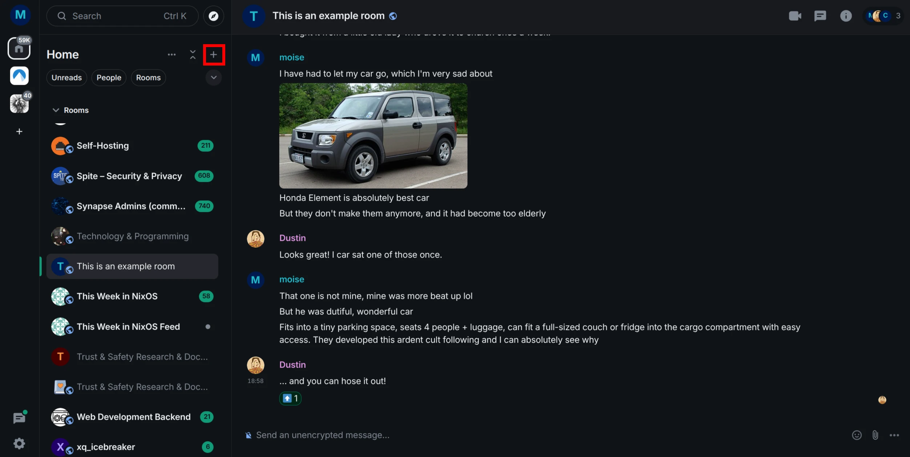
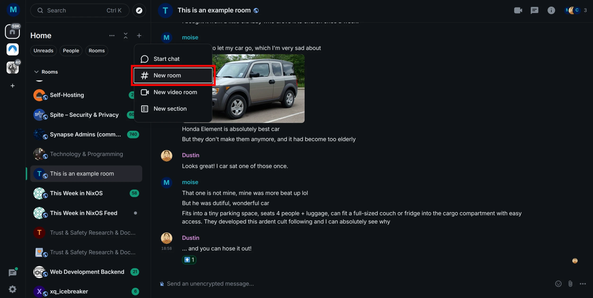
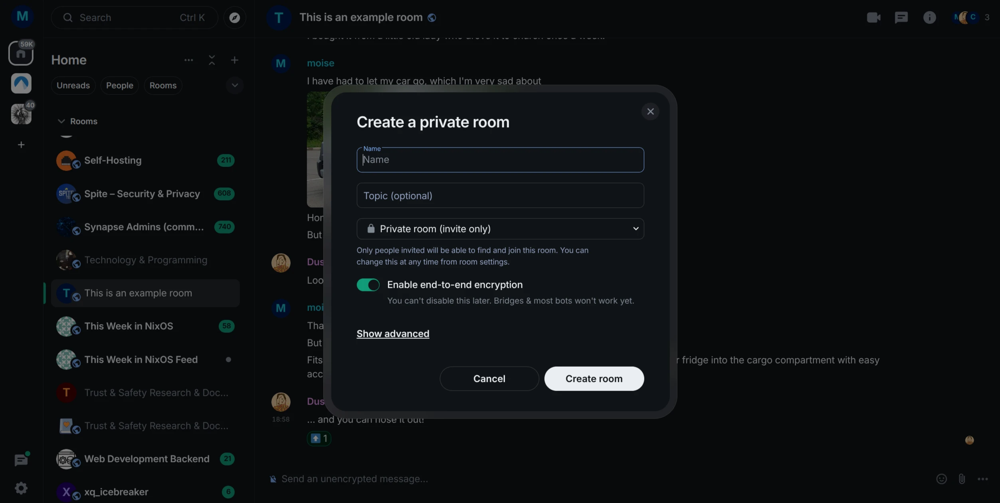
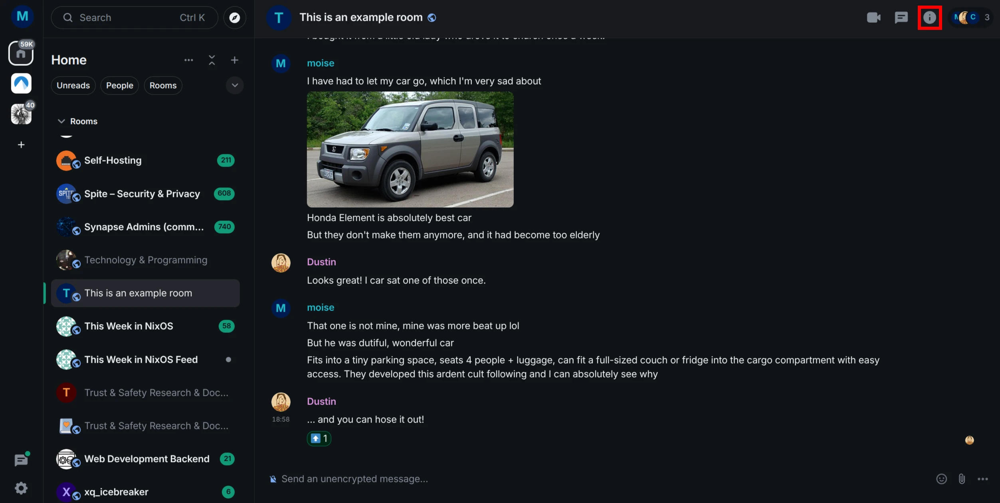
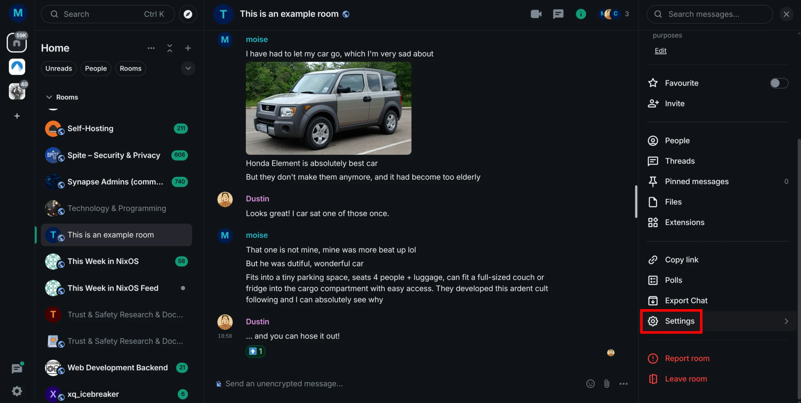
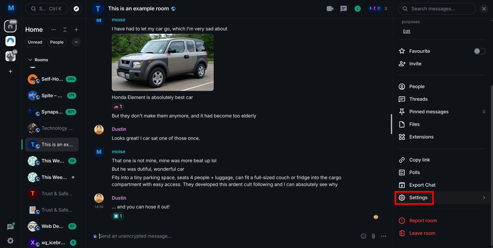
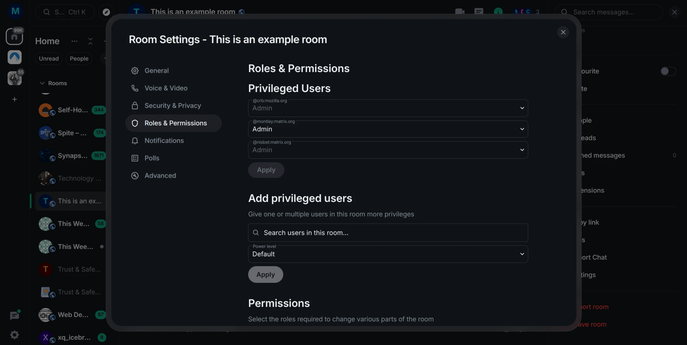
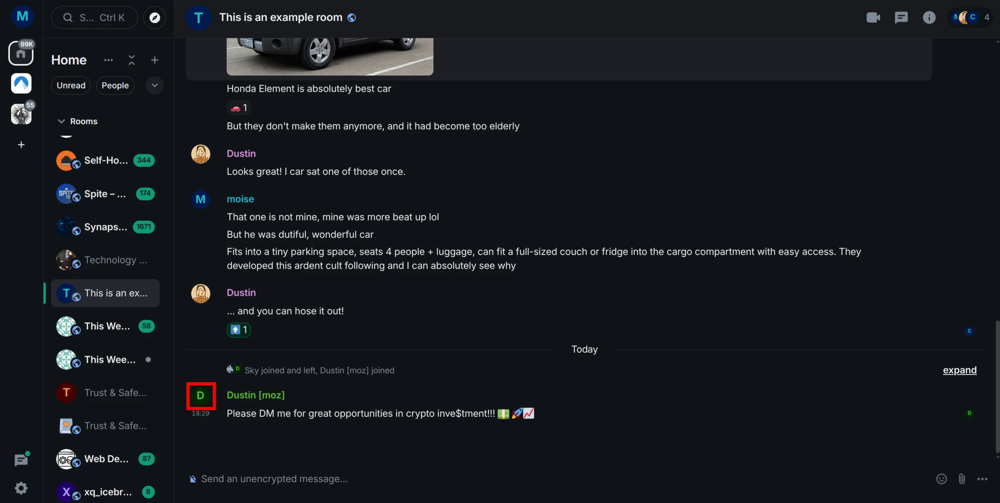
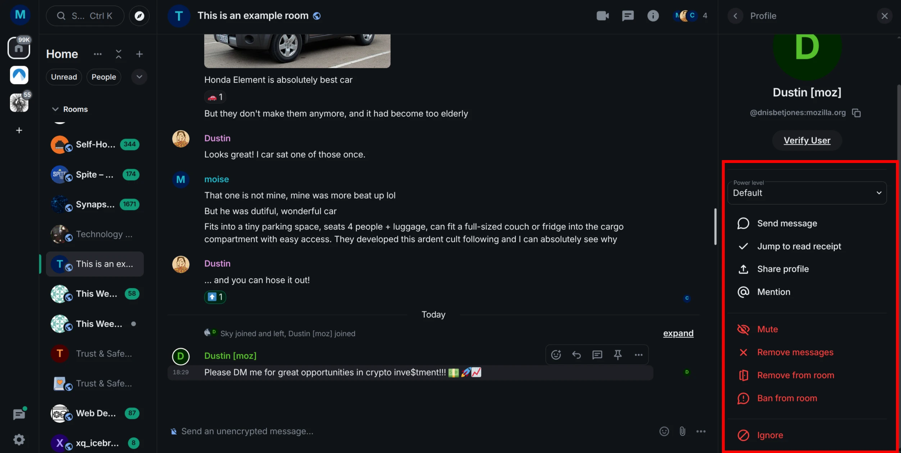

+++
title = "Community Moderation"
template = "docs/with_menu.html"
weight = 200
[extra]
emoji = "🛡️"
tile = "I want to deploy moderation tools"
updated = "2026-11-15T19:57:00Z"
meta_description = """
This is a guide to moderation and moderation tools on Matrix.
"""
+++

## Introduction

If you are a member of a community that could benefit from using a Matrix room to chat together, you're in luck, because Matrix was designed to be good at this job! This doc is an introduction to what you need to know to set up your room and keep it safe and successful.

The not-so-welcome news is that the more popular your Matrix room becomes, the more you will need to think about some of the more difficult topics, including how to deal with spam and problematic behaviour.

The good news is that you can start small and learn as you go. There are lots of popular, safe and fun community Matrix rooms, and lots of people who are ready and willing to share their experience about how to manage them. Keep reading for what we hope is a good start.

Coming up:

* Tips and info about Matrix (we call them "rooms", not "channels"!)
* How to get started (Matrix is decentralised, so you don't need to pick a server ... right?)
* Good choices for your room setup (should it be encrypted? should it be public?)
* Useful Matrix features (room topics, pinned messages)
* Starting out with the right expectations (how do we want people to behave?)
* Setting up a moderation team (do I need one? who should it be?)
* The job of moderation (how to delete messages? ban or silence users?)
* Automated tools that can help (moderation bots, policy servers)
* How to care for yourself and your moderation team

This document was written by volunteers, and is always a work in progress. If you'd like to submit proposed changes or find out about joining the T&S R&D working group, you can contact us in our Matrix room: [#tns-rnd-wg-office:neko.dev](https://matrix.to/#/#tns-rnd-wg-office:neko.dev)

## Getting started

The first step to setting up your community is to create the public room. The screenshots below are from Element Web, but other clients offer very similar controls. In the chat view, where you see a list of groups and messages, hit the `+` symbol.

From there, you will be offered an option to create a new room. Choose this and a dialog will pop up, asking you to choose a name and a topic and choose to make your room public or private.

If so, select "Public room". You will be given a field to create an alias, which is the human-readable name for your room on Matrix, rather than the random characters assigned as the room ID. This is how you will share the room and identify it to others. For example, the "Matrix HQ" room has alias `#matrix:matrix.org`.

Note: the room alias includes a homeserver name, but this doesn't mean that your room lives "on" that homeserver. In fact, a room can have many aliases using different homeserver names. Matrix rooms are shared across the homeservers of all the users in the room, so even if the original homeserver disappears, the room continues as if nothing happened!

* If you only want people you invite to be able to enter the room, choose "Private room". To prevent server admins (or people who break into the server) from reading your messages, enable end-to-end encryption.
* ⚠️ If you are creating a public room which will have a large membership, then **for performance and stability reasons you should not enable encryption.**

Create your room and your client will move you to it. In the room info you can find "Settings" which allows you to set a room topic and icon, and adjust moderation settings.

## Publicizing your room

So you have a public room! Now what? There are a number of ways people can discover public rooms:

* To be listed in your homeserver's room directory, enable "Publish this room to the public in the room directory?" in your room settings. But, depending on your server, this may not do anything: some homeservers have specific application processes. For example, to apply to be listed on matrix\.org's room directory, use [this form](https://matrix.org/homeserver/room-directory/).
* If you want to share a link to your room, use the format `https://matrix.to/#/#my-community:matrix.org`. Look for a "Copy link" button in the room info. (The `matrix.to` part is a web site that helps the person who clicks on the link to find the room within their own Matrix client.)
* You can submit your room to [matrixrooms.info](https://matrixrooms.info/), which allows searching for public Matrix rooms.

## Setting up a moderation team

When you get started, you can do all the admin by yourself, but as soon as your room becomes popular, you will need some support.

Your moderation team should be made up of people who have earned the trust of you and the people in your room, and they should be delegated responsibility gradually, as the level of trust they have earned increases. You and your moderation team need to work together to decide policies and processes that work for your community.

If possible, look for people who can be around at different times: even if your room is usually only active at specific times, this is helpful for combating spam, which can arrive at unusual times.

### Power levels

You can control the responsibility you delegate to someone by setting their "power level", which is a number, normally between 0 and 100. Usually, normal users have power level 0, moderators have 50 and admins have 100.

In the room's settings, you can control what is possible for users with different power levels, giving you fine-grained control. At first, it should be sufficient for you to promote your moderation team members to "Moderator" level. You can do this in your room's Settings area, or by clicking on individual people's icons.

⚠️ **Be very careful of setting someone's power level to the same as your own, because if you do so you can never decrease it again, so you are giving up control.**

⚠️ **Moderation bots are a better way of handling fine grained moderation privileges than power levels. Do not change powerlevels when under heavy load/under attack, and do not use powerlevels for muting or otherwise "deprivileging" users, as changing these settings when servers are overloaded can trigger inconsistencies that make your room stop working properly.**

### Types of moderators

The person who created a room has special powers, and they can never be demoted[^older-versions]. If you need to take control of a room away from its creator, your only option is to create a new room to replace the old one. If you have sufficient power level, you can perform a [room upgrade](@/docs/communities/administration/_index.md) instead.

Where possible, it's good to include at least one moderator for your room from a different homeserver, so moderation can continue even if your main account's homeserver is not working.

In a larger team, it is helpful to think about the different roles for moderators. Most likely you have some "custodial" moderators -- trusted individuals who can adjudicate complaints about behavior or deal with issues related to legitimate users who are stepping over the line in some specific interaction, and also some "janitorial" moderators, who can deal with drive-by spam or other misbehavior which is so obvious and unapologetic that it just needs a quick delete+ban.

[^older-versions]: Assuming your room version is v12 or newer -- in older room versions, the creator is an ordinary admin.

## Setting expectations

As your community grows and you start to recruit trusted members to help share the moderation burden, it will be important to start considering your code of conduct (CoC). Having a CoC in place sets the tone and expectations for all members and creates a welcoming space by reducing conflict. Additionally, your moderation team will have a set of guidelines to follow and moderate consistently.

You can make your CoC visible by linking to it from in the room topic (see the room Settings), or pinning a message in your room (write a message and then choose "pin").

If you are not sure how to create a CoC, you may find it helpful to read [the matrix.org code of conduct](https://matrix.org/legal/code-of-conduct/).

In addition to a CoC, we recommend writing a set of policies that explain what actions the moderation team will take in each circumstance. This will help the team to behave consistently and with clarity and confidence. You may want to share this policy with the room members, or keep it private to the moderation team.

It is very important to be clear and consistent in your moderation behaviour: this prevents conflict and helps people know what is expected of them ahead of time. Your moderation team need to talk to each other and work out difficult issues together. Your CoC and moderation policies will change over time, depending on the decisions you make together.

## Enforcing expectations

Most of the controls for dealing with specific users can be found by clicking on their user icon, if you have the appropriate powerlevel within the room. For example in Element Web:

Most clients provide controls for removing individual messages by hovering or clicking on the message itself.

There are two main classes of moderation activity you are likely to see in your room: spam and problematic behaviour. These are very different and require different responses.

### Dealing with spam

Spam is low-effort content that is not wanted by room members. It is often created automatically e.g. by bots.

The normal approach to spam is simply to remove the messages and ban the user. Most moderation bots (see "Moderation bots" below) have commands that will do this for you automatically. For example in Draupnir, you can type `!draupnir redact @user:example.com #my-room:example.com` to redact all messages by a user in a room. In Meowlnir it's `!redact @user:example.com`.

### Dealing with problematic behaviour

Problematic behaviour is when people who are members of a community behave in ways that are not acceptable. This is usually a violation of the code of conduct, but it could also be some new behaviour that is not yet covered by the CoC.

Different communities have very different ways of dealing with problematic behaviour, and each one needs to develop its own policies, so this document does not prescribe how to do it. Instead, we describe some of the actions that are available to you. Most likely, your policy will involve escalating gradually e.g. starting with a private or public warning, moving on to silencing or kicking the user if the problem continues, and then a temporary or permanent ban if needed.

#### Warnings

Most communities use some form of warning if behaviour is unacceptable or becoming close to unacceptable. These can be private warnings via a direct message to the user, or public warnings in the room where the behaviour happened.

Different communities use very different styles of warning, but it is usually a good idea to be clear:

* what behaviour was unacceptable and why,
* what the person should do or not do now,
* what will happen next if the behaviour does not change.

Ideally, all of this should be explained in the room's code of conduct, so you can refer to it in the warning. This makes it clear what is expected, and helps demonstrate that the rules apply to everyone, not just this user.

#### Kicking

Kicking someone means removing them from the room. If your room is invite-only, this removes them permanently, but for a public room, nothing prevents them from re-joining. (Often, the idea of a kick is to give a clear warning that some behaviour has been unacceptable and make it clear that the user will be banned if it continues.)

Usually a kicked user is allowed to re-join if and when they want to, but often there is a suggestion that they should calm down before they do so.

You can kick a user by clicking on their icon and choosing "Remove from room" (or similar) in your Matrix client, or using the `!kick @user:example.com` command in Meowlnir, or a similar command in a different bot. Most bots allow providing a reason for the kick, which can be used to give instructions or explain the action.

#### Banning

Banning someone removes them from the room and means they are not able to re-join even if it is a public room. You may decide to ban someone permanently, or give someone a timed ban. At the moment, there is not great tooling for timed bans, so you will need to set yourself a reminder and manually unban them when the time expires.

You can ban a user by clicking on their icon and choosing "Remove from room" (or similar) in your Matrix client, or using the `!draupnir ban @user:example.com` command in Draupnir, or a similar command in a different bot. Most bots allow providing a reason for the ban, which can be used to give instructions or explain the action.

### Alt accounts

Sometimes, a banned user will re-join the room using a new Matrix ID (an "alt" account). Many communities respond to this behaviour, when they identify that the user is an alt of a banned user, with an immediate ban, effectively treating this the same way as spam.

## Moderation bots

If you do more than a very small amount of moderation, you will almost certainly find a moderation bot helpful. Moderation bots join your room(s) and take actions on your behalf. They can fight spam by using community-created lists of banned users and they can automate your actions across several rooms. Some communities also find it useful to have a bot perform moderation actions, to diffuse aggression towards individual users. Some public room directories require you to use a moderation bot if your room is listed.

Normally, there is a separate "management" room which you use to control your bot. You join the management room and then type commands to the bot, and it follows your instructions in the main room (the one you are looking after). To do this, the bot must be invited to the main room, and be given sufficient permissions to do things like ban users and delete messages (usually bots used just to fight spam only need moderator permissions, and ones used more widely need to be admins).

Members of your moderation team can now be invited to the management room and also type commands to the bot. Commands are things like `!draupnir ban @user:example.com`, so you type that into the management room and the bot performs the action.

Bots need a server to run on: you can self-host them, or use a hosted service. Because your moderation bot has some level of control over your room, it's important to make sure you can trust whoever is hosting it.

Two commonly-used bots are:

* [Draupnir](https://the-draupnir-project.github.io/draupnir-documentation/), a more featureful and commonly-used bot which may be easier to set up and work with
* [Meowlnir](https://docs.mau.fi/meowlnir/), a newer moderation bot which can be faster, and includes some nice features Draupnir doesn't have

Bots will also give you help if you type something like `!help` or `!draupnir help` in their management room.

The simplest way to set up a bot for your room is to use a hosted service like [Asgard](https://asgard.chat/). To get a bot from Asgard, read the instructions in that link. At time of writing, you simply need to ask in the Asgard Matrix room explaining what you want to use the bot for and someone will set it up for you.

If you self-host your bot, you should consider signing up to some community-created ban lists to keep people out who are known spammers. The Asgard project maintains a useful page describing some of the available lists and how to sign up: [Subscribing to policy lists](https://asgard.chat/draupnir/subscribe-to-policy-lists.html).

## Policy servers

Bots are extremely useful and flexible tools for keeping your community safe, but they have one disadvantage: they need to receive messages before they can take action. This means that harmful content can only be removed by a bot after it has arrived in the room.

Policy servers provide an additional layer of protection that can apply before messages arrive at all. This means they can protect your room members from harmful content without waiting for it to arrive and then deleting it, potentially too late to prevent harm. They also allow additional levels of protection, such as muting users temporarily without kicking them from the room.

This way of working means policy servers need to integrate closely with the homeserver to evaluate message content before it is sent, making them a little more complex to set up than moderation bots. Where policy servers really shine is protecting rooms against active, automated attacks. The Matrix Foundation [recommends](https://matrix.org/blog/2025/12/policyserv/) using both bots and policy servers to protect public rooms.

You can self-host your own policy server by following the instructions under "Deploying" on the [policyserv](https://github.com/matrix-org/policyserv#deploying) page, but the easiest option is to use the policy server set up by the Matrix Foundation. To do this, follow the instructions for "Usage" on the [policyserv-setup-bot](https://github.com/matrix-org/policyserv-setup-bot#usage) page.

If you use the Matrix Foundation's policy server, the rules it uses to block harmful content are controlled by the foundation, aligned with the rules used in the foundation's official rooms. If you choose to self-host, you can control exactly what rules are used.

### Technical details

The servers in a room know which policy server to consult by looking for a specific "state event" in the room. If you use the foundation's setup bot, it will create this event automatically. You can change your mind about using a policy server, or change to use a different policy server by updating the `m.room.policy` state event. See [MSC4284](https://github.com/matrix-org/matrix-spec-proposals/pull/4284) for more details.

## Self care

It can be very stressful looking after communities: you can find yourself having very challenging conversations, making difficult decisions, and you may feel responsible for being present at all hours to prevent bad behaviour. Taking enforcement actions almost always involves some level of conflict, which tends to be draining.

It is important to set boundaries for yourself, and make clear what level of moderation you are providing. If the burden becomes heavy, it is useful (and important) to build a team of people who can help. It's also really important to find people you can talk through decisions with: people you trust can help make the best choices, and also help you feel settled after actions have been taken.

Because part of your role is to protect your community from harm, that does mean that sometimes you have to deal with harmful images or speech. This can cause trauma to you or your team. Hopefully, the vast majority of your time looking after your community will be pleasant and trauma-free, but if you do see things you would rather not see, we recommend using the resources listed at IFTAS' [Traumatic Content: Coping With Exposure](https://about.iftas.org/library/traumatic-content-coping-with-exposure/) page.

Quick tips if you've seen something that shocked you:

- Give yourself some time. Don't be surprised if it affects you! Be kind to yourself.
- Play a simple video game, preferably one with bright colours.
- Talk to someone you trust, and pay attention to how you are feeling.

## Further reading

If you'd like to learn more about trust and safety, we recommend the IFTAS [Community Library](https://about.iftas.org/trust-safety-services/iftas-community-library/), which contains lots of useful resources.

## Credits and contributing to this document

This document was written by members of the Trust and Safety Research and Documentation Working Group: Andy Balaam, Dustin, Andy Piper, Andy Moise, and others.

If you'd like to help improve it, please contact us in our working group Matrix room, [#tns-rnd-wg-office:neko.dev](https://matrix.to/#/#tns-rnd-wg-office:neko.dev). See you there!
